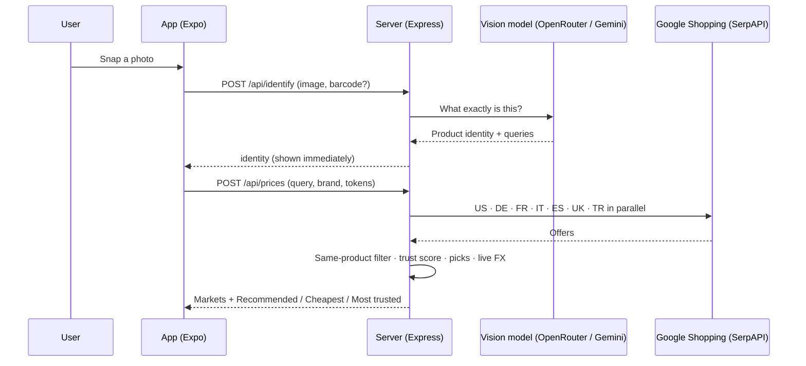

<p align="center">
  
</p>

<h1 align="center">SCOPE</h1>

<p align="center">
  <strong>Point your camera at a product. See where to buy it — cheapest and safest.</strong><br/>
  Identifies the exact product in seconds and compares new prices across the US, Europe and Türkiye.
</p>

<p align="center">
  
  
  
  
  
  
</p>

---

## What is SCOPE?

Point your camera at a product. In a couple of seconds SCOPE tells you **exactly what it is**,
then shows **where to buy it new** in the **US, Europe and Türkiye** — the cheapest offer, the
most trustworthy seller, and the best balance of the two.

1. **Identify** — one photo (plus a barcode when the camera sees one) goes to a fast vision model
   via OpenRouter or Gemini. The answer is the exact product: brand, model, the variant that moves
   the price, and shop-ready search queries.
2. **Price** — Google Shopping is searched in every country at once (US, DE, FR, IT, ES, UK, TR).
   Offers are filtered to the same new product (no accessories, no used/refurbished), every
   seller gets a trust score, and too-good-to-be-true prices are flagged.
3. **Decide** — a recommended buy, the cheapest and the most trusted offer, the typical new
   price, and a per-market list of stores with direct links.

SCOPE never invents a price: without live offers it says so and links to the store searches.

---

## ✨ Features

| | |
|---|---|
| ⚡ **Two-step scan** | Identity first (≈2 s), prices stream in after — you never stare at a spinner. |
| 🎯 **Exact match** | Reads logos, labels and barcodes; shows how sure it is and lets you correct it in one tap. |
| 🌍 **US · Europe · Türkiye** | All countries queried in parallel; prices shown in your currency with live FX, plus the store's own price. |
| 🛡️ **Seller trust** | Official brand stores › major retailers › marketplaces › unknown shops. Suspiciously cheap offers are flagged. |
| 🏷️ **Recommended / Cheapest / Most trusted** | Three clear answers, then the full list per market. |
| 🔖 **Saved items** | Keep a scan with its prices and refresh them later; synced across devices when signed in. |
| 🔒 **Responsible** | Age-restricted items keep prices but hide purchase links. |

---

## 🧭 How it works



---

## 🧱 Tech stack

| Layer | Technology |
|-------|-----------|
| **Mobile** | Expo (React Native), React Navigation, TanStack Query, react-native-svg, Reanimated |
| **Language** | TypeScript (`strict`) end-to-end |
| **Backend** | Express 4, Helmet, rate-limiting, Zod validation |
| **AI** | OpenRouter or Google Gemini (vision, model-fallback chain) |
| **Pricing** | SerpAPI (Google Shopping, 7 countries in parallel) + live FX |
| **Data** | PostgreSQL + Drizzle ORM |
| **Quality** | Vitest, ESLint, Prettier, typed CI checks |

---

## 🚀 Getting started

**Requirements:** Node 20+, and the [Expo Go](https://expo.dev/go) app or an iOS simulator.

```bash
npm install
cp .env.example .env        # add OPENROUTER_API_KEY (or GEMINI_API_KEY), optionally SERPAPI_KEY
PORT=4000 npm run server:dev
npx expo start              # scan the QR with Expo Go, or press i for the simulator
```

> A step-by-step guide in Turkish lives in [`KURULUM.md`](KURULUM.md).

### Environment

| Variable | Required | Purpose |
|----------|:--------:|---------|
| `OPENROUTER_API_KEY` or `GEMINI_API_KEY` | ✅ | Product identification |
| `OPENROUTER_MODELS` | – | Comma-separated vision models to try in order |
| `SERPAPI_KEY` | – | Live store prices and links (search links without it) |
| `PRICE_COUNTRIES` | – | Countries to query, default `US,DE,FR,IT,ES,UK,TR` |
| `DATABASE_URL` | – | Sync saved items across devices (device-only without it) |
| `POSTHOG_KEY`, `AMAZON_AFFILIATE_TAG`, … | – | Telemetry / affiliate links |

---

## 📁 Project structure

```
client/          Expo React Native app
  screens/         Scan (camera) · Result · Saved · Settings · Paywall · Auth
  components/      ui (Txt, Button, Chip, Skeleton…) · offers (cards, rows, tabs) · StoreAvatar
  contexts/        Auth (accounts + Pro) · Settings (display currency + live FX)
  services/        scanService (identify / prices) · portfolioService (saved items + sync)
  lib/             i18n (EN/TR) · quota · image-store · scan-session
server/          Express + TypeScript API
  identify.ts      /api/identify — vision prompt + normalisation
  pricing.ts       /api/prices — parallel country search, trust, picks, cache
  ai.ts            OpenRouter / Gemini client
  routes.ts        routes · saved-item sync · auth · RevenueCat webhook
shared/          scan contract (scan.ts) + Drizzle schema shared by app and server
```

---

## 🧪 Scripts

```bash
npm run check:types   # TypeScript (client + server)
npm test              # Vitest unit tests
npm run lint          # ESLint
npm run db:push       # Apply Drizzle schema
```

---

## 📜 License

Released under the MIT License — see [`LICENSE`](LICENSE).
